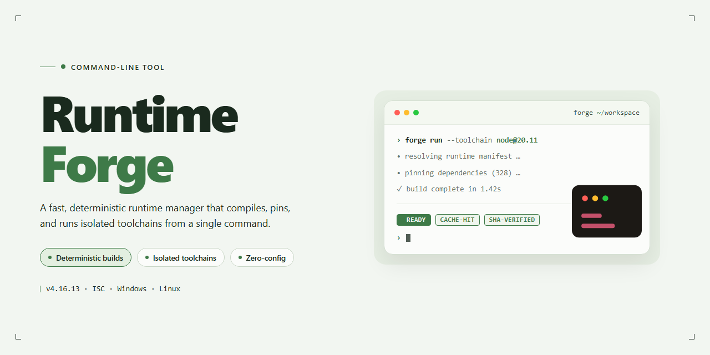

# Runtime Forge: Manage Installed Runtimes and Developer Toolchains for Windows

### 🚀 PowerShell Quick Install

   

---

Runtime Forge is a command-line utility for inspecting and managing installed Windows runtimes and developer tooling. It reports what is already present, then installs, updates, or removes DirectX, Visual C++ redistributables,.NET, Java, Python, Go, Rust, Git, Node, Windows Terminal, and more than 60 additional components. Every download is verified by publisher signature and/or SHA-256 hash before execution, and operations that modify system state require administrator rights. Scope is deliberately narrow: Runtime Forge targets Windows only and does not attempt cross-platform package management, nor does it replace a general-purpose package manager for arbitrary software.

## 🔧 Requirements

- **OS:** Windows 10 / 11
- **Shell:** PowerShell 5.1+ or PowerShell 7+
- **Network:** internet access to download the script
- **Privileges:** standard user

## Features

**Inventory, not guesswork.** `runtime-forge list` reports what is actually present for each supported component — DirectX, VC++ redistributables,.NET runtimes and SDKs, Java, Python, Go, Rust, Git, Node, Windows Terminal, and the rest of the 60+ catalog — by reading uninstall registry keys, filesystem markers, and Appx package state. Detection is per-component and machine-verified; a component whose detection cannot be confirmed is reported as unknown rather than absent.

- **Install, update, remove.** Each catalog entry declares its own pipeline: a `winget`-backed install where a reviewed manifest exists, or a native download → verify → `run_exe`/`run_msi` path otherwise. Update checks compare the installed version against the current release metadata; removal uses the recorded uninstall command when one is safe to run. Not every component has all three operations — entries without a safe uninstall expose install and update only.

- **Integrity checks before execution.** Every downloaded installer is verified twice: once on arrival and again immediately before it is launched. Verification requires either a valid Authenticode signature from the expected publisher via `WinVerifyTrust`, a SHA-256 matching the vendor's published digest or one pinned in source, or both. A failed check discards the staging file and is not retried. Packages routed through `winget` are checked by `winget` against its reviewed manifest hash.

- **Staging outside user-writable paths.** Installer downloads are staged beside the executable, in an administrator-writable location only. No installer is ever executed from a user-writable directory.

- **PATH backups.** Any operation that modifies `PATH` writes a timestamped backup of the previous value before the change, so a bad edit can be rolled back without reconstructing the environment by hand.

- **Optional components stay unchecked.** Components marked `optional` are never pre-selected in an install run. Each entry carries a one-line note describing what it is for, so the selection step is a decision rather than a default.

- **Theme and interface.** Dark and light themes are supported. The application is built on PyQt6.

- **Scope and limits.** Runtime Forge targets Windows only. It manages the components in its own catalog; it is not a general-purpose package manager and will not resolve arbitrary packages by name. Version metadata is refreshed from a daily-updated local manifest, so a release published between refreshes is not visible until the next update. Components that require a reboot to complete are reported as such and are not silently restarted. There is no telemetry, and none is planned.

## Usage

Runtime Forge is operated from a single entry point. Run the help output first to confirm the available commands and their argument order; the exact spelling of commands and flags is authoritative there and may change between versions.

The default invocation opens the GUI. Headless and scripted use go through the same binary with an explicit subcommand, so both paths share the catalog, the verification layer, and the logs.

Typical operations:

- List components and their detected state before changing anything.
- Install one or more named components.
- Update components that report a newer available version.
- Remove a component, when an uninstall path is defined for it.

Component identifiers are the catalog keys shown by the list command. Passing an unknown key fails with a non-zero exit code rather than guessing at a near match. Components marked optional are never selected implicitly.

Scope and behavior to be aware of:

- Verification is mandatory. Each installer is checked before it runs and again immediately before execution; a failed signature or hash check discards the file and is not retried. There is no flag to skip this.
- Administrator rights are required for install and remove operations, because the underlying installers request elevation. Listing and detection generally do not.
- The catalog is curated, not exhaustive. Roughly 60+ components are covered; anything outside the catalog is out of scope for this tool.
- Downloads and execution depend on the network and on the vendor's endpoints being reachable and unchanged. When a vendor withdraws or alters an artifact, that component fails verification by design.
- Windows is the only supported platform. Behavior on other systems is untested and unsupported.
- Exit codes are meaningful: success, verification failure, and argument or catalog errors are distinguished. Scripts should branch on the exit code, not on parsed console text.

Logs are written alongside the executable. Review them when a component fails verification or an installer exits unexpectedly.

## Flags

`-list` prints every catalog entry with its key, display name, category, and detection status, then exits. Use it to discover valid keys for the other flags.

`-status <key>` reports the detected state of one component: `installed`, `outdated`, `missing`, or `unknown` (detection could not run). Exit code is `0` for installed/outdated, `1` for missing, and `2` for unknown, so it can be scripted.

`-install <key>[,<key>...]` runs the install pipeline for the given keys in order. Accepts multiple keys separated by commas or repeated occurrences. Optional components are skipped unless named explicitly.

`-update <key>[,<key>...]` updates only components that are installed and outdated. Already-current components are left untouched; missing components are reported and skipped.

`-remove <key>[,<key>...]` uninstalls a component through its registered uninstaller. Components with no safe uninstall path are reported and left installed — the command never falls back to deleting files directly.

`-all` widens `-update` or `-remove` to every eligible component. With `-install` it installs all non-optional components. Combining `-all` with an explicit key list is rejected.

`-dry-run` resolves what each action would do — downloads, verification, installs, uninstalls — and prints the plan without executing it. Verification outcomes are not known until execution, so the plan shows the expected signer or hash rather than a confirmed result.

`-force` re-runs the pipeline for a component even if detection reports it as installed or current. Verification still runs; the flag bypasses detection, not integrity checks.

`-verify-only` downloads the artifacts a normal run would fetch, checks their signature and/or SHA-256, reports pass or fail per component, and stops before executing anything.

`-no-verify` is intentionally not provided. Verification cannot be disabled from the command line; a failing check discards the artifact and the component is retried on a subsequent run.

`-yes` answers yes to interactive confirmation prompts. Without it, each install or remove asks for confirmation when the terminal is attached to an interactive session.

`-quiet` suppresses progress output and prints only final per-component results. `-verbose` prints each pipeline step, including the resolved download source and the verification decision.

`-json` emits machine-readable output on stdout for the selected action. Progress and warnings go to stderr. The shape is stable enough for scripting but is not a versioned API.

`-log <path>` writes a run log to the given file, in addition to stdout. The default logs to the staging directory beside the executable.

`-no-color` disables ANSI styling in terminal output, for parsers and non-ANSI terminals.

`-version` and `-help` print the tool version and the full flag reference, respectively, and exit without touching the system.

Flags that modify a target set (`-install`, `-update`, `-remove`) require at least one key or `-all`; the tool exits with a usage error otherwise. `-install`, `-update`, and `-remove` are mutually exclusive within one invocation — issue separate runs, or let the default action (install missing, update outdated) handle a mixed set.

## Recipes

**Inventory before touching anything.** `runtime-forge list` prints every catalog entry with its key, display name, detected state, and installed version. Detection reads the registry Uninstall keys, on-disk markers, and Appx packages — nothing is inferred from PATH alone. Use `-installed` or `-missing` to filter; `-json` emits the same data for scripting.

- **Dry-run first when the target machine matters.** `runtime-forge install dry-run git node` resolves the plan — download source, expected publisher, expected hash — without writing or executing anything. The output is the same plan the real run will follow, so a diff between the two is meaningful.

- **Install a named set, not "everything".** `runtime-forge install vcredist python go` installs only the named keys. Keys are the catalog identifiers, not display names; `runtime-forge list keys` prints them one per line. Unknown keys fail the whole invocation before any download starts.

- **Update only what is already present.** `runtime-forge update present` re-resolves versions for components detected as installed and skips the rest. This is the intended path for repeat runs on an existing machine; a plain `update` with no filter treats the full catalog as a candidate set.

- **Remove with the uninstaller the vendor ships.** `runtime-forge remove node` invokes the registered uninstaller when one exists and refuses when it does not, rather than deleting files directly. Components without a safe uninstall path are marked as such in `list` output and will not be offered for removal.

- **Verify a download without running it.** `runtime-forge fetch verify-only <key>` downloads to the staging directory, runs the Authenticode and SHA-256 checks, reports pass or fail, then discards the file. Useful for confirming a catalog entry still resolves to a valid artifact before a batch run.

- **Pin the catalog for reproducible machines.** `runtime-forge catalog <path> list` and the same flag on `install` read a local catalog file instead of the bundled one. Combined with `-json` output from a known-good machine, this gives you an explicit, reviewable component set rather than whatever the current release ships.

- **Script the exit codes.** `0` means every requested operation succeeded. `1` means at least one component failed verification or installation. `2` means the invocation itself was rejected — bad key, missing privilege, unreadable catalog — and nothing was attempted. Batch scripts should branch on these rather than parsing stdout.

- **Run elevated only when required.** `list`, `-dry-run`, and `fetch verify-only` do not need elevation. Install, update, and remove do: installers are staged in an admin-writable directory beside the executable and never in a user-writable location, and this is checked at startup rather than discovered mid-run.

Scope note: Runtime Forge manages the components in its catalog. It does not resolve arbitrary package names, does not act as a general package manager, and does not modify a component's configuration beyond what its own installer does. If a key is not in `list`, it is not handled.

## FAQ

**Is Runtime Forge a package manager?**

No. It is a curated installer and inventory tool for a fixed catalog of Windows runtimes and developer tools. It does not resolve dependency graphs, does not maintain a global package database, and does not replace `winget`, `choco`, or `scoop`. Where a component is winget-backed, Runtime Forge acts as a front end to winget's reviewed manifests and inherits its hash checking; it does not add a second layer of resolution on top.

**Which Windows versions are supported?**

Windows 10 and Windows 11, x64. ARM64 is not a tested target. Components that ship only x86 or x64 installers will still run under emulation on ARM64, but detection and uninstall behavior in that configuration is unverified. Windows 7 and 8.1 are out of scope.

**Does it need administrator rights?**

Yes, for anything that installs, updates, or removes. The tool stages installers in a directory adjacent to the executable, which is writable only by administrators, and it launches installers elevated. Running as a standard user without elevation will let you inspect the inventory but not modify it.

**What does "verified" mean here, precisely?**

Two checks, applied before execution and repeated immediately prior to launch: an Authenticode signature chain validated against an expected publisher name, and/or a SHA-256 digest matched against a published or pinned value. A failure discards the staged file and does not retry. This is a check on provenance and integrity at download time — it is not a sandbox, and it does not audit what the vendor's installer does once it runs. Installers execute with the privileges you granted them.

**Can I use it offline or behind a proxy?**

No offline mode. Every install path fetches from the vendor or from winget, so network access is required. Proxy support is whatever the underlying transport honors in your environment; there is no in-app proxy configuration screen. If your network intercepts TLS, signature and hash checks will fail closed rather than silently pass.

**Why is a component missing or marked optional?**

Components are added deliberately, each with a pinning strategy and a detection method that has been verified on a real machine. Optional components are never pre-selected and never installed as part of a bulk run. If something you want is absent, it is usually because no reliable integrity signal or safe uninstall path exists for it yet — not an oversight.

**Does it modify PATH or other system state?**

It can. PATH changes are made with a backup taken beforehand, and the backup is retained so the previous state can be restored. Registry-based detection reads Uninstall keys; it does not write them outside of what an installer itself does. There is no system restore point creation and no rollback beyond the PATH backup — uninstalling a component relies on the vendor's own uninstaller.

**How current is the component catalog?**

Version selection data refreshes on a daily schedule. That means the catalog can lag a vendor release by up to a day, and a yanked or re-signed upstream release may briefly point at a digest that no longer matches. In that case the install fails closed and the entry is corrected on the next refresh. The tool does not silently fall back to an unverified build.

**Are updates automatic?**

No background updater and no telemetry. Update checks happen only when you invoke them, and the results are only as good as the detection logic for each component. Components installed outside Runtime Forge may be detected but will not be managed by it.

**What is explicitly out of scope?**

Non-Windows platforms, portable or per-user installs that bypass elevation, silent unattended deployment across a fleet, license management, and any form of configuration of the installed tools after the fact. It installs, updates, removes, and reports. Nothing else.

## License

Runtime Forge is released under the MIT License.

Copyright (c) xechostormx

Permission is hereby granted, free of charge, to any person obtaining a copy
of this software and associated documentation files (the "Software"), to deal
in the Software without restriction, including without limitation the rights
to use, copy, modify, merge, publish, distribute, sublicense, and/or sell
copies of the Software, and to permit persons to whom the Software is
furnished to do so, subject to the following conditions:

The above copyright notice and this permission notice shall be included in all
copies or substantial portions of the Software.

THE SOFTWARE IS PROVIDED "AS IS", WITHOUT WARRANTY OF ANY KIND, EXPRESS OR
IMPLIED, INCLUDING BUT NOT LIMITED TO THE WARRANTIES OF MERCHANTABILITY,
FITNESS FOR A PARTICULAR PURPOSE AND NONINFRINGEMENT. IN NO EVENT SHALL THE
AUTHORS OR COPYRIGHT HOLDERS BE LIABLE FOR ANY CLAIM, DAMAGES OR OTHER
LIABILITY, WHETHER IN AN ACTION OF CONTRACT, TORT OR OTHERWISE, ARISING FROM,
OUT OF OR IN CONNECTION WITH THE SOFTWARE OR THE USE OR OTHER DEALINGS IN THE
SOFTWARE.

Scope note: this license covers the Runtime Forge source code and its bundled
assets. It does not extend to any third-party runtime, redistributable, or
package that Runtime Forge downloads and installs on your behalf. Each such
component remains governed by its own publisher's license terms, which you
accept when you choose to install or update it. Runtime Forge verifies
signatures and hashes before execution and performs no redistribution of those
components; it merely fetches them from their official sources at your request.